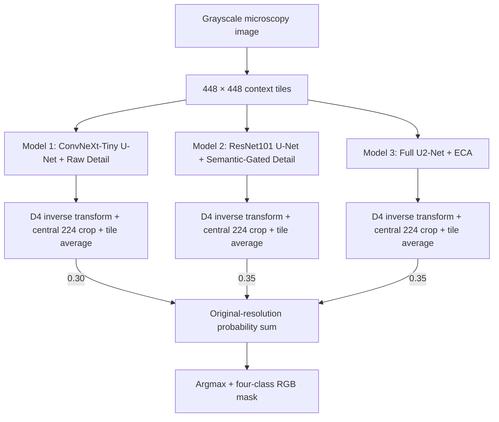

# KoMaP-AI-COMPETITION-2026

고탄성 알루미늄 합금의 광학현미경 영상에서 **Primary Si · Al₃Ni · Eutectic Si · Al**을 픽셀 단위로 분할하는 팀 프로젝트입니다. ConvNeXt-Tiny, ResNet101, U²-Net·ECA 기반 세 모델의 예측 확률을 결합합니다.

**최종 Validation mIoU 81.0183% · 최고 단일 모델 대비 +0.6322%p · 20장 중 17장 개선**

Train 70장 / Validation 20장 / Test 10장의 제공 분할을 유지했습니다. 아래 성능은 모델·체크포인트·앙상블 선택에 사용한 **Validation 결과**입니다. Test 정답 기반 점수는 산출하지 않았습니다.

## 최종 모델과 결과

| 모델 | 해결하려는 문제와 주요 구조 | 학습 / 선택 epoch | D4 mIoU | 앙상블 비중 |
|---|---|---:|---:|---:|
| Model 1 — 상세 보정형 | ConvNeXt-Tiny U-Net/scSE의 문맥 특징과 raw grayscale 상세 경로 결합 | 300 / 172 | 80.3762% | 30% |
| Model 2 — 의미 게이트형 | ResNet101 U-Net/scSE의 의미 특징으로 상세 경로의 기여를 조절 | 300 / 184 | 80.3861% | 35% |
| Model 3 — 다중해상도형 | Full U²-Net의 중첩 RSU와 ECA로 다중 해상도·채널 특징 활용 | 150 / 135 | 80.2360% | 35% |
| **최종 확률 앙상블** | **원본 좌표에서 30:35:35 가중합 후 argmax** | — | **81.0183%** | **100%** |

Model 1·2는 ImageNet 인코더로 초기화하고, Model 3은 사전학습 없이 학습합니다. 공통 입력은 448×448이며 학습 감독은 Model 1·2 전체 448×448, Model 3 중앙 224×224입니다.

| 클래스 | 최고 단일 모델(Model 2) IoU | 최종 IoU | 변화 |
|---|---:|---:|---:|
| Primary Si | 90.9422% | 91.6279% | +0.6857%p |
| Al₃Ni | 76.0801% | 76.3736% | +0.2935%p |
| Eutectic Si | 60.2396% | 61.6317% | +1.3921%p |
| Al | 94.2825% | 94.4400% | +0.1575%p |

mIoU는 영상별 네 클래스 IoU의 평균을 구한 뒤 20장에 대해 동일 평균합니다. 정답과 예측에 모두 없는 클래스는 IoU=1로 처리하며, 전체 픽셀을 합산하는 pooled IoU와 구분합니다. [모델 구조·학습·추론 상세](docs/FINAL_MODELING_KO.md)

## 전체 파이프라인



세 모델은 서로 다른 내부 패키지를 사용하므로 **독립 Python 프로세스에서 순차 실행**합니다. 공통 추론·앙상블 코드는 `src/`에 모았으며 모델별 학습 소스는 원래 import 구조를 유지합니다.

## 저장소 구조

```text
src/
  infer.py                 # 세 모델 추론 후 최종 앙상블
  inference.py             # 공통 체크포인트 검사·확률/마스크 저장
  ensemble.py              # 고정 30:35:35 확률 결합
  metrics.py               # 공통 팔레트·Validation 평가
  model_factory.py         # 최종 Model 1/2 구성·Cutout·GC
  model{1,2,3}/
    model.py, train.py, infer.py
    code/                  # 모델별 보존 구현·학습 의존 코드
resources/
  settings.json            # 데이터 경로·device·split
  model{1,2,3}/config.json  # 체크포인트에 대응하는 고정 recipe
  ensemble.json            # 모델 순서·가중치·기준 성능
  checkpoints.json         # 체크포인트 SHA256·epoch
  environment.yaml         # Linux/CUDA 재현 환경
  licenses/                # 기반 소스 출처·라이선스
Thirdparty/weights/         # 별도 제공 ImageNet 가중치; Git 제외
run/checkpoints/            # 별도 제공 최종 best.pt; Git 제외
run/inference/              # 생성 확률·마스크·평가 결과; Git 제외
run/retraining/             # 새 학습 결과; Git 제외
experiments/                # 기존 비교 실험별 코드·설정
mimu/, 루트 Python 파일     # 기존 실험 실행 경로; 최종 진입점은 src/
docs/                      # 결과·실험 근거·실행 및 과거 기록
```

데이터, 체크포인트, 대용량 확률·마스크는 저장소에 포함하지 않습니다. 기존 실험 코드를 이동하면 과거 실행 경로가 바뀌므로 원래 위치에 보존했습니다. [문서 안내](docs/README.md)

## 실행

### 1. 환경과 별도 가중치 준비

기존의 호환 환경을 우선 사용하세요. 재현 기준은 Linux / Python 3.10.21 / PyTorch 2.7.1+cu128 / torchvision 0.22.1+cu128이며 전체 버전은 [environment.yaml](resources/environment.yaml)에 있습니다. 모델 1·2 학습 코드의 `fcntl` 의존성 때문에 Windows에서는 WSL/Linux가 필요합니다.

별도 공유된 가중치 ZIP의 파일을 다음 위치에 배치합니다.

```text
02_program/models/model1/best.pt  → run/checkpoints/model1/best.pt
02_program/models/model2/best.pt  → run/checkpoints/model2/best.pt
02_program/models/model3/best.pt  → run/checkpoints/model3/best.pt
02_program/Thirdparty/weights/   → Thirdparty/weights/
```

Model 1·2의 구조 생성에는 `convnext_tiny-983f1562.pth`, `resnet101-cd907fc2.pth`도 필요합니다. 프로그램은 가중치를 자동 다운로드하지 않으며 체크포인트 해시·epoch·설정과 state dict를 검사합니다. [파일 배치 계약](resources/FINAL_MODELS.md)

### 2. 데이터와 split 설정

[resources/settings.json](resources/settings.json)을 수정합니다. `data_root`는 저장소 루트 기준 상대경로 또는 절대경로이며 원본 데이터 폴더를 직접 지정할 수 있습니다.

```json
{
  "data_root": "/path/to/Data",
  "device": "cuda:0",
  "split": "test"
}
```

```text
Data/
  train/images/  train/masks/
  valid/images/  valid/masks/
  test/images/
```

원본 영상은 `*_image.png`, 정답은 대응하는 `*_mask.png` 파일입니다. [데이터 준비 안내](docs/DATA_AND_REPRODUCIBILITY_KO.md)

### 3. 추론

저장소 루트에서 실행합니다.

```bash
python src/infer.py
```

최종 RGB PNG는 `run/inference/ensemble/{split}/masks/`, 확률은 같은 split의 `probabilities/`에 저장됩니다. `split=valid`에서는 20장의 평가 결과를 `metrics.json`에 기록하고, `split=test`에서는 10장을 처리합니다.

```bash
# 단일 모델만 실행할 때
python src/model1/infer.py
python src/model2/infer.py
python src/model3/infer.py

# 세 모델의 확률 파일이 이미 있을 때
python src/ensemble.py
```

### 4. 새 학습

```bash
python src/model1/train.py
python src/model2/train.py
python src/model3/train.py
```

고정된 seed42 recipe로 새로 학습하며 `run/retraining/modelN/` 아래에 저장합니다. 기존 출력 폴더가 있으면 시작하지 않으며, 배포 체크포인트는 덮어쓰지 않습니다. 추론만 재현할 때는 재학습이 필요하지 않습니다.

## 실험과 선택 근거

- **모델별 개선:** Model 1은 경계 샘플링·Cutout·GC, Model 2는 서로 다른 원본의 batch 구성·Squared Dice를 채택했습니다. 같은 변경이라도 모델별 결과가 달라 조건을 각각 선택했습니다.
- **학습 기간:** 비중을 고정한 150/150/150, 300/300/300, 300/300/150 비교에서 최종 혼합 기간 구성이 높았습니다.
- **앙상블:** 검토한 5% 비중 격자에서 30:35:35가 최고였고, 동일 비중도 80.9997%였습니다. 연속 가중치 공간 전체의 최적성을 뜻하지는 않습니다.
- **증강:** 별도 R03 비교에서 대비 제거·노이즈 축소는 mIoU를 높였지만 접촉부 오류가 증가했습니다. 밝기 축소의 별도 T4 재검증은 3개 seed 모두 하락했습니다. 최종 세 모델의 직접 제거 실험과 구분합니다.

[최종 모델링과 결과](docs/FINAL_MODELING_KO.md) · [증강 실험 원자료 집계](docs/AUGMENTATION_EXPERIMENTS_KO.md) · [실험 이력 안내](docs/README.md)

## 재현 범위와 한계

보고서의 최종값은 제출 패키지 재추론 마스크 기준입니다. 탐색 당시 값과 약 0.000004%p 차이가 있었으며 경계 1픽셀 차이에 해당합니다. 설정에는 [탐색 기준값과 재현값](resources/ensemble.json)을 함께 기록했습니다.

같은 Validation으로 모델과 비중을 선택해 선택 편향이 남으며, 시편 단위 독립성은 확인되지 않았습니다. Eutectic Si와 경계 오류가 남아 새로운 시편·촬영 조건에서 검증이 필요합니다. 면적 비율을 물성으로 직접 해석하거나 실시간 처리를 보장하지 않습니다.

이번 저장소 정리는 최종 구조·가중치·확률 합산 순서를 유지합니다. CPU 구조 비교와 실행·앙상블 검사는 수행하되, 별도 가중치와 CUDA 환경이 필요한 전체 Validation/Test 추론 및 재학습을 새로 수행한 결과로 표기하지 않습니다.

```bash
python -m pytest tests/test_final_pipeline.py -q
```

검사 범위와 결과는 [검증 기록](docs/VALIDATION_20261015_KO.md)에 정리했습니다.

기반 알고리즘과 소스 출처: [licenses](resources/licenses/SOURCES.txt). 과거 2026-10-08 시점 README는 [기록 문서](docs/README_HISTORY_20261008.md)에 보존했습니다.
