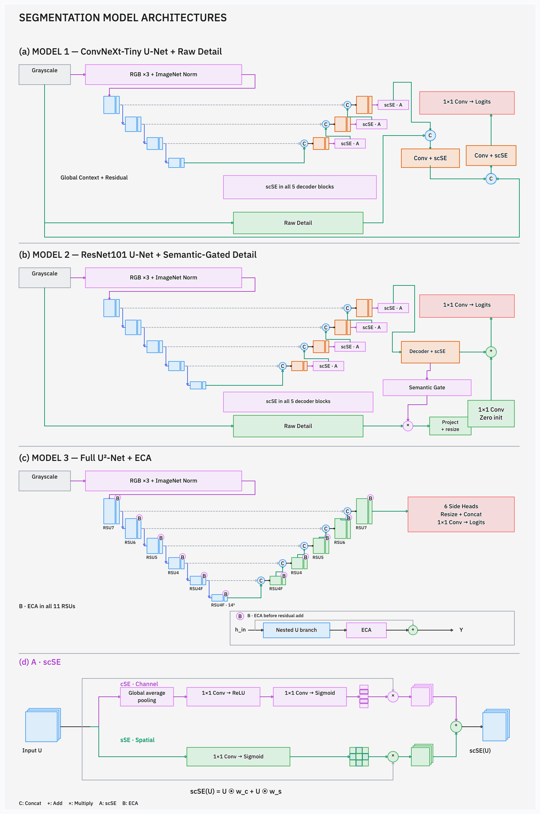

# KoMaP-AI-COMPETITION-2026

고탄성 알루미늄 합금의 광학현미경 영상에서 **Primary Si · Al₃Ni · Eutectic Si · Al**을 픽셀 단위로 분할하는 팀 프로젝트입니다. ConvNeXt-Tiny, ResNet101, U²-Net·ECA 기반 세 모델의 예측 확률을 결합합니다.

**최종 Validation mIoU 81.0183% · 최고 단일 모델 대비 +0.6322%p · 20장 중 17장 개선**

Train 70장 / Validation 20장 / Test 10장의 제공 분할을 유지했습니다. 아래 성능은 모델·체크포인트·앙상블 선택에 사용한 **Validation 결과**입니다. Test 정답 기반 점수는 산출하지 않았습니다.

## 분석 배경과 접근

광학현미경 영상에서는 밝기가 유사한 상을 밝기만으로 구분하기 어렵고, 작은 입자와 가는 경계는 축소 과정에서 위치 정보가 손실될 수 있습니다. 본 프로젝트는 **원본 해상도의 문맥과 세부 형상을 함께 학습**하고, 서로 다른 세 모델의 오류를 확률 앙상블로 보완합니다.

Train 70장의 EDA에서 확인한 문제를 다음 설정에 반영했습니다.

| EDA 관찰 | 모델링에 반영한 설정 |
|---|---|
| Eutectic Si 면적 비중 6.98%; 해당 상이 10% 이상인 중앙 패치 후보는 18.54% | 일반·표적 추출 50:50, Al₃Ni·Eutectic Si 표적 균등 선택, Dice·Lovasz에서 Eutectic Si 가중치 2배 |
| 1/2 축소 후 복원 시 원래 Eutectic Si 픽셀의 16.06%가 다른 라벨로 변경 | 입력을 미리 축소하지 않고 448×448 문맥 패치 추출 |
| 영상별 패치 후보 수 24~108개로 최대 4.5배 차이 | 후보 전체에서 바로 뽑지 않고 원본 영상을 먼저 균등 선택 |

위 수치는 Train 분석 결과이며, 축소·복원에 따른 라벨 변경률은 모델의 예측 오류율과 구분합니다.

## 최종 모델과 결과

| 모델 | 해결하려는 문제와 주요 구조 | 학습 / 선택 epoch | D4 mIoU | 앙상블 비중 |
|---|---|---:|---:|---:|
| Model 1 — 상세 보정형 | ConvNeXt-Tiny U-Net/scSE의 문맥 특징과 raw grayscale 상세 경로 결합 | 300 / 172 | 80.3762% | 30% |
| Model 2 — 의미 게이트형 | ResNet101 U-Net/scSE의 의미 특징으로 상세 경로의 기여를 조절 | 300 / 184 | 80.3861% | 35% |
| Model 3 — 다중해상도형 | Full U²-Net의 중첩 RSU와 ECA로 다중 해상도·채널 특징 활용 | 150 / 135 | 80.2360% | 35% |
| **최종 확률 앙상블** | **원본 좌표에서 30:35:35 가중합 후 argmax** | — | **81.0183%** | **100%** |

Model 1·2는 ImageNet 인코더로 초기화하고, Model 3은 사전학습 없이 학습합니다. 공통 입력은 448×448이며 학습 감독은 Model 1·2 전체 448×448, Model 3 중앙 224×224입니다.

| 클래스 | 최고 단일 모델(Model 2) IoU | 최종 IoU | 변화 |
|---|---:|---:|---:|
| Primary Si | 90.9422% | 91.6279% | +0.6857%p |
| Al₃Ni | 76.0801% | 76.3736% | +0.2935%p |
| Eutectic Si | 60.2396% | 61.6317% | +1.3921%p |
| Al | 94.2825% | 94.4400% | +0.1575%p |

mIoU는 영상별 네 클래스 IoU의 평균을 구한 뒤 20장에 대해 동일 평균합니다. 정답과 예측에 모두 없는 클래스는 IoU=1로 처리하며, 전체 픽셀을 합산하는 pooled IoU와 구분합니다. [모델 구조·학습·추론 상세](docs/FINAL_MODELING_KO.md)

## 모델 아키텍처

아래 이미지는 **보고서에 사용한 아키텍처 그림을 그대로** 수록했습니다. 클릭하면 원본 크기로 볼 수 있습니다.

[](resources/images/report-architectures.png)

파란색은 인코더, 주황색은 디코더, 점선은 skip connection, `C`는 특징 연결입니다. `A`는 scSE, `B`는 RSU 내부 ECA의 적용 위치입니다.

### Model 1 — ConvNeXt-Tiny U-Net + Raw Detail

**주변 문맥을 활용하면서 작은 상의 세부 정보를 디코더까지 전달**하기 위한 모델입니다. ImageNet 초기화 ConvNeXt-Tiny와 scSE 디코더를 사용하고, 전역 문맥·잔차 연결·SiLU를 적용했습니다. 정규화 전 grayscale을 별도 상세 경로로 처리하여 224×224 디코더에 연결하고, 원본 grayscale도 마지막 448×448 디코더에 연결합니다.

전체 448×448 정답으로 학습하며 경계가 많은 패치를 우선 선택합니다. Cutout, Gradient Centralization, 모든 클래스를 대상으로 한 Lovasz를 사용했습니다.

448×448 입력 기준의 특징 크기는 다음과 같습니다. 다섯 디코더 블록 모두 두 번의 3×3 합성곱·BN·SiLU 뒤 scSE를 적용하고, 0 초기화한 1×1 projection 잔차를 더합니다. scSE는 채널 가중치와 위치 가중치를 각각 특징에 곱한 결과를 합산합니다.

| 단계 | 공간 크기 | 채널 / 결합 |
|---|---:|---|
| Encoder E1 → E4 | 112² → 56² → 28² → 14² | 96 → 192 → 384 → 768 |
| Decoder 4 → 2 | 28² → 56² → 112² | 깊은 특징과 skip 연결 → 256 → 128 → 64 |
| Global context | 28² | 256채널 특징의 GAP → 1×1 Conv → broadcast 잔차 덧셈 |
| Raw detail | 224² | grayscale → stride-2 Conv 1→16 → 병렬 depthwise 3×3·5×5 보정 |
| Decoder 1 | 224² | 의미 64 + 상세 16 연결 → 64 |
| Decoder 0 / head | 448² | 특징 64 + grayscale 1 연결 → 32 → 4 logits |

상세 보정은 두 depthwise 분기의 ReLU 출력을 연결하고 1×1 Conv로 16채널에 투영한 뒤 원래 상세 특징에 더합니다. 투영을 0으로 초기화하여 학습 시작 시 기본 상세 특징을 유지합니다. **총 파라미터: 32,458,571개.**

### Model 2 — ResNet101 U-Net + Semantic-Gated Detail

**상세 정보의 기여를 의미 특징에 따라 조절**하기 위한 모델입니다. ImageNet 초기화 ResNet101과 scSE 디코더의 의미 특징으로 sigmoid 게이트를 만들고, 별도 grayscale 상세 특징에 곱합니다. 이를 채널 투영·보간한 뒤 의미 특징에 더하며, 마지막 잔차 합성곱의 가중치는 0으로 초기화했습니다.

전체 448×448 정답으로 학습하고 배치의 네 패치를 서로 다른 원본에서 추출합니다. 영상별 Squared Dice와 정답에 존재하는 클래스의 Lovasz를 사용하며, Cutout·Gradient Centralization은 적용하지 않았습니다.

| 단계 | 공간 크기 | 채널 / 결합 |
|---|---:|---|
| ResNet stem | 224² | 7×7 stride-2 Conv → BN → ReLU, 64채널 |
| Encoder E1 → E4 | 112² → 56² → 28² → 14² | 256 → 512 → 1024 → 2048 |
| Decoder 4 → 1 | 28² → 56² → 112² → 224² | skip 연결 후 256 → 128 → 64 → 64 |
| Decoder 0 | 448² | 의미 특징 F, 32채널; 각 디코더에 scSE 적용 |
| Raw detail D | 224² | stride-2 Conv → 16채널, 병렬 depthwise 3×3·5×5 잔차 보정 |
| Semantic gate G | 224² | F 보간 → 1×1 Conv 32→16 → sigmoid |
| Residual fusion / head | 448² | D⊙G → 1×1 Conv 16→32 → 보간 → 0 초기화 Conv → F에 덧셈 → 4 logits |

게이트는 의미 경로가 제공하는 문맥으로 상세 경로를 조절합니다. 마지막 잔차 합성곱이 0으로 초기화되므로 초기에는 의미 경로의 특징을 그대로 사용하고, 학습하면서 상세 보정량을 조정합니다. **총 파라미터: 51,614,459개.**

### Model 3 — Full U²-Net + ECA

**중첩된 다중 해상도 특징으로 앞선 두 모델과 다른 예측을 확보**하기 위한 모델입니다. 6개 인코더·5개 디코더의 총 11개 outer RSU에서 잔차 특징에 ECA를 적용합니다. 여섯 side output을 같은 크기로 복원·연결하여 최종 logits를 만듭니다.

사전학습 없이 학습하고 중앙 224×224 영역에만 손실을 적용합니다. 손실은 융합 출력에만 적용하며 별도 deep supervision은 사용하지 않습니다.

| 단계 | 공간 크기 | RSU / 출력 채널 |
|---|---:|---|
| Encoder 1 → 3 | 448² → 224² → 112² | RSU7/64 → RSU6/128 → RSU5/256 |
| Encoder 4 → 6 | 56² → 28² → 14² | RSU4/512 → RSU4F/512 → RSU4F/512 |
| Decoder 5 → 1 | 28² → 56² → 112² → 224² → 448² | skip 연결 → RSU4F/512 → RSU4/256 → RSU5/128 → RSU6/64 → RSU7/64 |
| Side heads / fusion | 모두 448²로 복원 | 최심부 encoder + 5개 decoder의 4채널 출력을 연결(24채널) → 1×1 Conv → 4 logits |

RSU는 내부 U 분기의 다중 해상도 특징을 입력 합성곱 특징에 더하는 블록입니다. RSU4F는 추가 pooling 대신 dilation을 사용합니다. ECA는 잔차 분기에서 **GAP → 채널 축 Conv1d(kernel=3) → sigmoid → 채널별 곱**을 수행한 뒤 입력 특징과 더합니다. Model 3에는 scSE를 사용하지 않습니다. **총 파라미터: 44,051,485개.**

> 그림은 경로를 요약한 개념도입니다. 실제 Model 1의 상세 경로 결합은 디코더에서의 concatenation이며, Model 2의 `α init = 0` 표시는 마지막 잔차 합성곱의 0 초기화를 뜻합니다. 별도 학습 scalar α는 없습니다.

### 공통 학습 설정

입력 grayscale을 [0,1]로 조정하고 모델 내부에서 **3채널 반복 → ImageNet 평균·표준편차 정규화**를 적용합니다. Model 1·2의 raw detail 경로는 정규화 전 입력을 사용합니다. Model 3도 같은 정규화를 사용하지만 사전학습 가중치는 사용하지 않습니다.

| 항목 | 설정 |
|---|---|
| Seed / batch / epoch당 패치 | 42 / 4 / 420 |
| Optimizer | AdamW, 초기 학습률 3×10⁻⁴, weight decay 10⁻⁴ |
| Scheduler | 모델별 학습 기간에 맞춘 cosine scheduler |
| 손실 | 0.5 CE + 0.25 Dice + 0.25 Lovasz |
| Dice·Lovasz 클래스 가중치 | [1, 1, 2, 1]; CE는 클래스 가중치 없음 |
| 증강 | 90° 단위 회전, 수평 반전, 밝기·대비, 감마, 가우시안 노이즈; Model 1만 Cutout 추가 |

모델별 Dice·Lovasz 계산 방식과 증강 순서는 [상세 모델링 문서](docs/FINAL_MODELING_KO.md)에 명시했습니다.

## 추론과 앙상블

각 모델은 448×448 입력의 중앙 224×224 예측을 stride 112로 복원하고 D4 8시점과 중첩 영역의 확률을 평균합니다. 최종 예측은 `0.30 P₁ + 0.35 P₂ + 0.35 P₃`에 argmax를 적용합니다.

| 구성 | Validation mIoU |
|---|---:|
| 최고 단일 모델: Model 2 D4 | 80.3861% |
| Model 1·2, 40:60 | 80.8450% |
| 세 모델 동일 비중 | 80.9997% |
| **최종 30:35:35** | **81.0183%** |

검토한 양의 5% 비중 격자에서 30:35:35가 가장 높았습니다. 학습·구조·실험 조건은 [상세 문서](docs/FINAL_MODELING_KO.md)에서 확인할 수 있습니다.

## 저장소 구조

```text
src/
  infer.py                 # 세 모델 추론 후 최종 앙상블
  inference.py             # 공통 체크포인트 검사·확률/마스크 저장
  ensemble.py              # 고정 30:35:35 확률 결합
  metrics.py               # 공통 팔레트·Validation 평가
  model_factory.py         # 최종 Model 1/2 구성·Cutout·GC
  model{1,2,3}/
    model.py, train.py, infer.py
    code/                  # 모델별 보존 구현·학습 의존 코드
resources/
  settings.json            # 데이터 경로·device·split
  model{1,2,3}/config.json  # 체크포인트에 대응하는 고정 recipe
  ensemble.json            # 모델 순서·가중치·기준 성능
  checkpoints.json         # 체크포인트 SHA256·epoch
  environment.yaml         # Linux/CUDA 재현 환경
  licenses/                # 기반 소스 출처·라이선스
Thirdparty/weights/         # 별도 제공 ImageNet 가중치; Git 제외
run/checkpoints/            # 별도 제공 최종 best.pt; Git 제외
run/inference/              # 생성 확률·마스크·평가 결과; Git 제외
run/retraining/             # 새 학습 결과; Git 제외
tests/                     # 최종 파이프라인 검증
docs/                      # 모델 설명·결과·실험 기록(Markdown)
  experiments/             # 과거 실험 설명; 실행 코드는 보관 브랜치
```

데이터, 체크포인트, 대용량 확률·마스크는 저장소에 포함하지 않습니다. main에는 최종 학습·추론에 필요한 코드만 남겼습니다. 실험 설명과 측정값은 Markdown으로 보존하고, 과거 실행 코드·설정·릴리스는 [보관 브랜치](https://github.com/leesangwon393/KoMaP-AI-COMPETITION-2026/tree/archive/experiments-before-cleanup-20261015)에 남겼습니다. [문서 안내](docs/README.md)

## 실행

### 1. 환경과 별도 가중치 준비

기존의 호환 환경을 우선 사용하세요. 재현 기준은 Linux / Python 3.10.21 / PyTorch 2.7.1+cu128 / torchvision 0.22.1+cu128이며 전체 버전은 [environment.yaml](resources/environment.yaml)에 있습니다. 모델 1·2 학습 코드의 `fcntl` 의존성 때문에 Windows에서는 WSL/Linux가 필요합니다.

별도 공유된 가중치 ZIP의 파일을 다음 위치에 배치합니다.

```text
02_program/models/model1/best.pt  → run/checkpoints/model1/best.pt
02_program/models/model2/best.pt  → run/checkpoints/model2/best.pt
02_program/models/model3/best.pt  → run/checkpoints/model3/best.pt
02_program/Thirdparty/weights/   → Thirdparty/weights/
```

Model 1·2의 구조 생성에는 `convnext_tiny-983f1562.pth`, `resnet101-cd907fc2.pth`도 필요합니다. 프로그램은 가중치를 자동 다운로드하지 않으며 체크포인트 해시·epoch·설정과 state dict를 검사합니다. [파일 배치 계약](resources/FINAL_MODELS.md)

### 2. 데이터와 split 설정

[resources/settings.json](resources/settings.json)을 수정합니다. `data_root`는 저장소 루트 기준 상대경로 또는 절대경로이며 원본 데이터 폴더를 직접 지정할 수 있습니다.

```json
{
  "data_root": "/path/to/Data",
  "device": "cuda:0",
  "split": "test"
}
```

```text
Data/
  train/images/  train/masks/
  valid/images/  valid/masks/
  test/images/
```

원본 영상은 `*_image.png`, 정답은 대응하는 `*_mask.png` 파일입니다. [데이터 준비 안내](docs/DATA_AND_REPRODUCIBILITY_KO.md)

### 3. 추론

저장소 루트에서 실행합니다.

```bash
python src/infer.py
```

최종 RGB PNG는 `run/inference/ensemble/{split}/masks/`, 확률은 같은 split의 `probabilities/`에 저장됩니다. `split=valid`에서는 20장의 평가 결과를 `metrics.json`에 기록하고, `split=test`에서는 10장을 처리합니다.

```bash
# 단일 모델만 실행할 때
python src/model1/infer.py
python src/model2/infer.py
python src/model3/infer.py

# 세 모델의 확률 파일이 이미 있을 때
python src/ensemble.py
```

### 4. 새 학습

```bash
python src/model1/train.py
python src/model2/train.py
python src/model3/train.py
```

고정된 seed42 recipe로 새로 학습하며 `run/retraining/modelN/` 아래에 저장합니다. 기존 출력 폴더가 있으면 시작하지 않으며, 배포 체크포인트는 덮어쓰지 않습니다. 추론만 재현할 때는 재학습이 필요하지 않습니다.

## 실험과 선택 근거

- **모델별 개선:** Model 1은 경계 샘플링·Cutout·GC, Model 2는 서로 다른 원본의 batch 구성·Squared Dice를 채택했습니다. 같은 변경이라도 모델별 결과가 달라 조건을 각각 선택했습니다.
- **학습 기간:** 비중을 고정한 150/150/150, 300/300/300, 300/300/150 비교에서 최종 혼합 기간 구성이 높았습니다.
- **앙상블:** 검토한 5% 비중 격자에서 30:35:35가 최고였고, 동일 비중도 80.9997%였습니다. 연속 가중치 공간 전체의 최적성을 뜻하지는 않습니다.
- **증강:** 별도 R03 비교에서 대비 제거·노이즈 축소는 mIoU를 높였지만 접촉부 오류가 증가했습니다. 밝기 축소의 별도 T4 재검증은 3개 seed 모두 하락했습니다. 최종 세 모델의 직접 제거 실험과 구분합니다.

[최종 모델링과 결과](docs/FINAL_MODELING_KO.md) · [증강 실험 원자료 집계](docs/AUGMENTATION_EXPERIMENTS_KO.md) · [실험 이력 안내](docs/README.md)

## 재현 범위와 한계

보고서의 최종값은 제출 패키지 재추론 마스크 기준입니다. 탐색 당시 값과 약 0.000004%p 차이가 있었으며 경계 1픽셀 차이에 해당합니다. 설정에는 [탐색 기준값과 재현값](resources/ensemble.json)을 함께 기록했습니다.

같은 Validation으로 모델과 비중을 선택해 선택 편향이 남으며, 시편 단위 독립성은 확인되지 않았습니다. Eutectic Si와 경계 오류가 남아 새로운 시편·촬영 조건에서 검증이 필요합니다. 면적 비율을 물성으로 직접 해석하거나 실시간 처리를 보장하지 않습니다.

이번 저장소 정리는 최종 구조·가중치·확률 합산 순서를 유지합니다. CPU 구조 비교와 실행·앙상블 검사는 수행하되, 별도 가중치와 CUDA 환경이 필요한 전체 Validation/Test 추론 및 재학습을 새로 수행한 결과로 표기하지 않습니다.

```bash
python -m pytest tests/test_final_pipeline.py -q
```

검사 범위와 결과는 [검증 기록](docs/VALIDATION_20261015_KO.md)에 정리했습니다.

기반 알고리즘과 소스 출처: [licenses](resources/licenses/SOURCES.txt). 과거 2026-10-08 시점 README는 [기록 문서](docs/README_HISTORY_20261008.md)에 보존했습니다.
